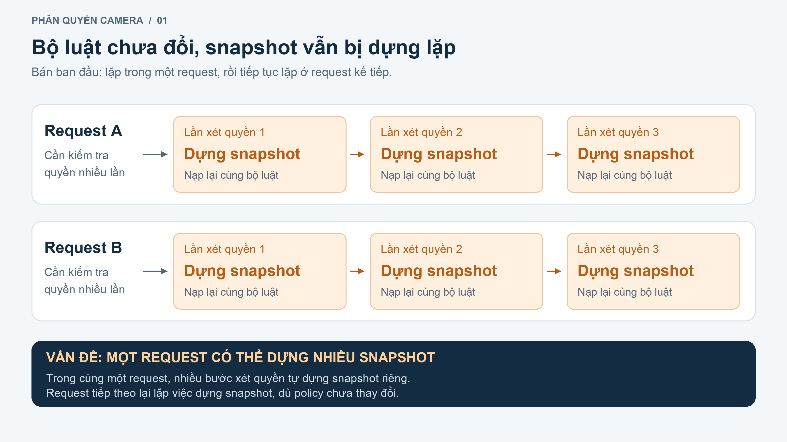
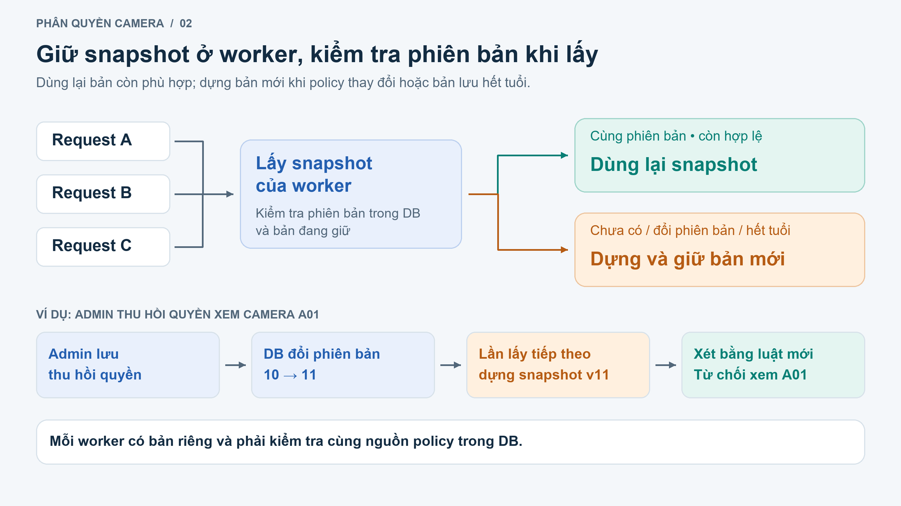
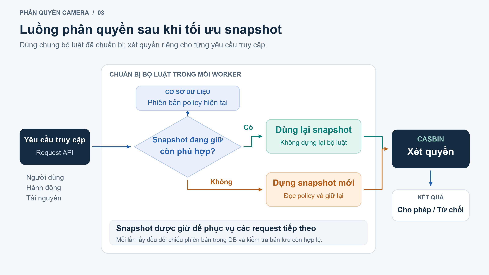

# Báo cáo cải tiến cơ chế dựng snapshot phân quyền

## 1. Vấn đề ở buổi báo cáo trước

Vấn đề của hệ thống là **bộ luật phân quyền bị dựng lại nhiều lần trong quá trình xử lý một request, và các request tiếp theo cũng tiếp tục dựng lại dù quyền chưa thay đổi**. Việc lặp xảy ra cả bên trong một request lẫn giữa các request khác nhau.

Khi người dùng yêu cầu xem camera, backend cần kiểm tra người đó có được phép xem hay không. Các quy định phân quyền, gọi là policy, được lưu trong cơ sở dữ liệu. Trước khi xét quyền bằng Casbin, hệ thống phải đọc và dựng snapshot các quy định này, kiểm tra và nạp vào các bộ máy xét quyền.

1 request có thể đi qua nhiều bước kiểm tra quyền, nhưng các bước này chưa dùng chung bộ luật đã chuẩn bị. Vì vậy, một bước cần xét quyền thì dựng snapshot; đến bước tiếp theo cần xét quyền lại dựng một snapshot khác. Nội dung policy có thể vẫn giống nhau, nhưng phần chuẩn bị bộ luật vẫn bị thực hiện lặp lại.

Như vậy, chi phí nằm ở việc hệ thống phải chuẩn bị lại cùng một bộ luật nhiều lần. Mỗi lần dựng đều cần đọc policy, kiểm tra dữ liệu và tạo các bộ máy xét quyền. Khi có nhiều request, phần công việc lặp này tăng theo và tạo thêm các đối tượng trong bộ nhớ. Vì thế, vấn đề cần xử lý là cách tổ chức việc chuẩn bị và sử dụng snapshot: bộ luật còn phù hợp thì nên được dùng lại cho những bước xét quyền tiếp theo.

## 2. Đã triển khai giải quyết như thế nào?

Hệ thống xử lý theo hai bước tương ứng với hai mức lặp trên. **Bước đầu là cho các bước xét quyền trong cùng một request dùng chung snapshot.** Khi request cần bộ luật lần đầu, hệ thống dựng một bản; các bước sau trong request có thể dùng lại bản đó khi policy vẫn phù hợp. Với luồng đã đo trước đây, thay đổi này giảm số lần dựng từ **57 xuống 1**. Tuy nhiên, đây mới là dùng chung trong một request: khi request mới đến, hệ thống vẫn cần dựng lại một bản khác.

**Bước tiếp theo, đã triển khai trong lần này, là giữ snapshot ở từng worker để dùng lại giữa các request.** Snapshot đã dựng không còn chỉ được giữ trong thời gian xử lý request hiện tại. Request A đến khi worker chưa có bản phù hợp thì dựng và giữ lại. Sau đó, request B và C đi vào cùng worker có thể dùng lại bản này nếu policy không đổi và bản lưu còn hợp lệ. Các request vẫn kiểm tra quyền riêng theo người dùng, hành động và camera được yêu cầu; phần dùng chung là bộ luật đã chuẩn bị.

Điểm cần xử lý khi giữ lại snapshot là làm sao biết lúc nào nó đã cũ. Hệ thống sẽ dùng thông tin phiên bản policy trong DB, trong đó có số phiên bản gọi là revision. Khi hệ thống thay đổi quyền và lưu thành công, nội dung policy cùng phiên bản được cập nhật trong cùng một lần ghi. Mỗi lần lấy snapshot để xét quyền, backend kiểm tra trạng thái và phiên bản trong DB rồi đối chiếu với bản đang giữ. Nếu cùng phiên bản và bản lưu còn hợp lệ thì dùng lại; nếu đã khác thì dựng bản mới trước khi trả snapshot.

Ví dụ worker đang giữ phiên bản 10, trong đó Alice được phép xem camera A01. Admin thu hồi quyền của Alice và lưu thành công, phiên bản trong DB chuyển sang 11. Đến lần lấy snapshot tiếp theo, hệ thống nhận ra bản trong bộ nhớ là 10 còn DB đã là 11, nên dựng lại bộ luật theo phiên bản mới. Việc xét quyền sau đó dùng bản 11 và phản ánh quyền đã bị thu hồi. Nhờ vậy, snapshot được dùng lại khi policy ổn định và được thay thế khi có thay đổi.

Với nhiều worker, mỗi worker giữ bản riêng nhưng đều kiểm tra cùng nguồn policy trong DB. Nếu worker A nhận request trước sau khi quyền thay đổi, A phát hiện phiên bản mới và dựng lại trước. Worker B khi lấy snapshot tiếp theo cũng tự kiểm tra DB và cập nhật bản của mình. Điều kiện là các worker phải thật sự đọc cùng nguồn dữ liệu phân quyền. Nếu mỗi container Docker chứa một file DB riêng biệt thì cơ chế này không tự đồng bộ các file DB đó.

Hệ thống cũng bổ sung xử lý cho trường hợp nhiều request đến đồng thời khi worker chưa có snapshot. Trong cùng worker, với cùng DB, phần dựng được kiểm soát để một luồng chuẩn bị bản dùng chung, các request còn lại chờ rồi dùng kết quả phù hợp. Khi policy thay đổi, hệ thống tạo bản mới thay vì sửa trực tiếp bộ luật mà request khác đang dùng. Những thay đổi quyền chưa lưu thành công được xét riêng và không đưa vào cache chung; nếu thao tác bị hủy thì dữ liệu đang sửa không ảnh hưởng bản dùng chung.

## 3. Hiện trạng sau khi giải quyết

Trong sơ đồ, worker giữ snapshot ở khung giữa để nhiều request có thể dùng lại. **Với các request đọc đã kiểm thử, hệ thống không còn phải dựng snapshot mới mỗi lần.** Sau khi kiểm tra bộ luật vẫn còn dùng được, hệ thống lấy bản có sẵn. Casbin vẫn kiểm tra riêng từng yêu cầu, chẳng hạn người dùng này có được xem camera này hay không.

Trước lần cải tiến này, mỗi request vẫn phải dựng một snapshot riêng. Sau cải tiến, kết quả kiểm thử cho thấy: request đầu tiên dựng một snapshot và giữ lại; request tiếp theo vào cùng worker dùng lại bản đó nên không phải dựng thêm, vì policy chưa đổi và snapshot vẫn còn hợp lệ. Khi admin thu hồi quyền và lưu thành công, request tiếp theo phát hiện policy đã thay đổi, dựng một snapshot mới rồi xét quyền theo bộ luật mới.

Ngoài việc đếm số lần dựng snapshot, kiểm thử còn kiểm tra hệ thống có trả đúng quyền hay không. Khi quyền chưa thay đổi, bản trước và sau cải tiến trả về cùng kết quả. Khi thu hồi quyền của Alice rồi gửi yêu cầu mới, camera A01 không còn trong danh sách Alice được xem. Kết quả này cho thấy hệ thống dùng lại được snapshot nhưng vẫn áp dụng quyền mới sau khi thu hồi.

Đã chạy **102 test về snapshot và các chức năng phân quyền liên quan, tất cả đều đạt**. Các test kiểm tra cả lúc nhiều request đến cùng lúc, admin thu hồi quyền, thay đổi quyền bị hủy và DB gặp lỗi. Khi chạy hai worker cùng đọc một DB, cả hai đều nhận biết quyền mới; worker được khởi động lại cũng đọc đúng bộ luật hiện tại. Phép đo riêng dùng 6 request trên DB tạm, gồm cả đăng nhập, không gọi API backend đang chạy hoặc API model.

